# Our Plan

## Why we are doing this

We want to build a hardware product for this course, since this is what interests us the most and gives us the biggest freedom in building what we want.

### The question we started with

We started with the exact question that came up in the very first intensive class: how does the data actually arrive where we want it?

To be more specific: solar systems all over Germany send their data back to the manufacturer of the inverter (often a company in China), so that the owner can watch the output of their system in an app. The panels themselves do not send anything. It is the inverter, the device that turns the panels' power into electricity for the house, that measures the values and sends them out. So why can't we read that data locally, inside the house, and display it right there, instead of taking the detour through the manufacturer's cloud?

### Why we think there is a market

While this question came from pure curiosity (and, to be fair, having an actual microcontroller and Raspberry Pi to fiddle around with just sounds like a lot of fun), we actually think that there might be a market for this.

Jannik and Daniel both work in the field, in slightly different areas, and they both think that homeowners and investors would like to have a display at home showing the data. Sure, they can look at their phone, but that's boring. Having a trophy hanging on your wall that reminds you that you have PV on your roof is something we believe people would want.

### What this means for the product

If we want to build and sell something like this, it must be as modular as possible, so that it works with as many manufacturers as possible and we could install it in any home that has PV on the roof.

## How we want to do this

### A prototype at CODE

The plan is to use the PV system that CODE already has (solar panels with a Hoymiles microinverter) to build a prototype. This lets us learn as much as possible and allows us to make as many mistakes as early as possible.

## What we want to build

### The idea in short

A small screen that hangs on the wall at home and shows what the PV system on the roof is doing right now. It gets the data straight from the inverter over the home network, without the detour through the manufacturer's cloud. For now it only reads. We don't want to be the people who accidentally switched off someone's solar system.

### Two systems, two ways in

We have two systems we can test on, and they could hardly be more different:

- **Hoymiles at CODE:** The microinverter only talks by radio and has no network connection at all. So we need a translator: an ESP32 with a radio module running OpenDTU, an open-source firmware that talks to the inverter by radio and passes the values on via MQTT.
- **Sigenergy via Jannik's installer:** Here the inverter (Sigenergy calls it the Energy Controller) is already on the network. We can just ask it for the values every few seconds via Modbus TCP.

So both inverters have the data. One just speaks our language, the other one needs an interpreter.

### The hardware

This part is actually decided, mostly because the university had to buy it:

- Raspberry Pi 4 with 2 GB RAM (114 €)
- ESP32 (12 €), the radio module is already at CODE
- 7 inch touchscreen (63 €)

That's 189 € in total. 2 GB of RAM is not a lot, so whatever we build has to stay lean.

### The software

Here we are honest: we don't know yet. We have a rough idea of how the parts connect, but there are a lot of little steps in between that we will only figure out once we sit in front of it. And that's okay.

What we do know is what the hardware gives us. Hoymiles talks MQTT, Sigenergy talks Modbus, and in the end something has to show it on a screen. So roughly: something reads the data, something stores it, something shows it. How exactly that looks, which language and which libraries, we'll see along the way.

That's also the idea from the first intensive: if the interfaces between the parts are clear, the parts behind them can be swapped. That includes the language they're written in.

### A little experiment on the side

Since we'll use Claude for coding anyway, we want to try something: build one small part in Python and the same part in a language that compiles, and see how well Claude does with each. Our guess is that Python goes a lot smoother, but that's just a guess and we want to find out. A compiled program also usually needs less memory, which with 2 GB of RAM isn't the worst argument. And honestly, learning a compiled language along the way doesn't hurt either.

### How it all connects

```mermaid
graph LR
    subgraph hoy[Hoymiles system at CODE]
        panelH[Solar panels] -->|DC cable| inv[Hoymiles HM-800<br/>microinverter]
        subgraph dtu[OpenDTU unit]
            nrf[Radio module<br/>NRF24L01+] -->|wired, SPI| esp[ESP32<br/>running OpenDTU]
        end
        inv -->|2.4 GHz radio<br/>OpenDTU asks, inverter answers| nrf
    end

    subgraph sig[Sigenergy system via installer]
        panelS[Solar panels] -->|DC cable| ec[Sigen Energy Controller<br/>hybrid inverter]
    end

    router{{Home router<br/>Wi-Fi / LAN}}

    subgraph pi[Raspberry Pi 4 - our device]
        broker[MQTT broker<br/>Mosquitto] -->|MQTT: broker pushes<br/>to subscriber| app[Our program<br/>drivers, core, SQLite]
        app -->|REST: history<br/>WebSocket: live values| browser[Browser<br/>full screen]
    end

    esp -->|MQTT publish<br/>OpenDTU starts| router
    router -->|MQTT| broker
    ec -->|Modbus TCP, port 502<br/>Pi asks every few seconds| router
    router -->|Modbus TCP| app
    browser -->|DSI ribbon cable| screen[7-inch<br/>touchscreen]

    classDef ours fill:#e8f1ff,stroke:#2d6bd6,color:#1b2530
    classDef theirs fill:#fff6d6,stroke:#c99a00,color:#1b2530
    classDef net fill:#f2f2f2,stroke:#888,color:#1b2530
    class esp,nrf,broker,app,browser,screen ours
    class panelH,inv,panelS,ec theirs
    class router net
    style hoy fill:#fafafa,stroke:#bbb
    style sig fill:#fafafa,stroke:#bbb
    style dtu fill:#ffffff,stroke:#2d6bd6,stroke-dasharray: 5 4
    style pi fill:#ffffff,stroke:#2d6bd6
```

The arrows show which way the data flows. Blue is the stuff we build or set up, yellow is the solar systems that already exist.

If this looks familiar: it's basically the setup from the first intensive (`panel.py` → broker → `api.py` → dashboard). The difference is that our broker sits in the home network instead of somewhere public on the internet.
